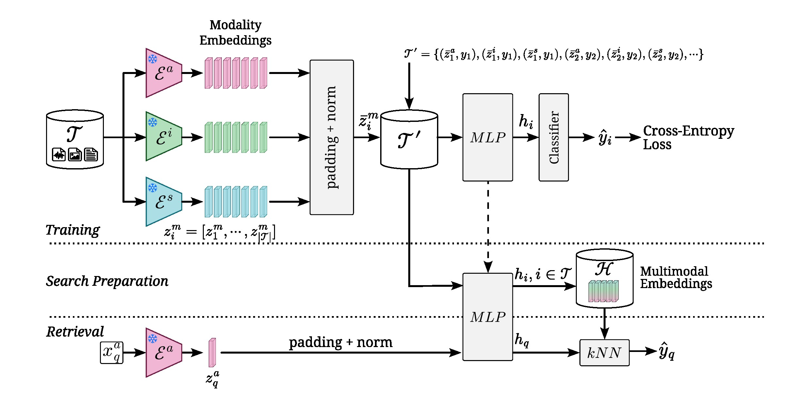

<p align='center'>
  <a href='https://praig.ua.es/'></a>
</p>

<h1 align='center'>TriScore: Aligning Audio, Symbolic Scores, and Sheet Music Images in a Shared Embedding Space</h1>

<h4 align='center'>Full text yet to be published<a href='/' target='_blank'></a>.</h4>

<p align='center'>
  
  
  
</p>

<p align='center'>
  <a href='#about'>About</a> •
  <a href='#how-to-use'>How To Use</a> •
  <a href='#citations'>Citations</a> •
  <a href='#acknowledgments'>Acknowledgments</a>
</p>

## About

This repository contains the official implementation for the experiments presented in the accompanying paper: **TriScore: Aligning Audio, Symbolic Scores, and Sheet Music Images in a Shared Embedding Space**

Multimodal representation learning has attracted increasing attention in Music Information Retrieval (MIR), yet score-based multimodality is still constrained by the lack of datasets that jointly provide audio, notation-level symbolic scores, and sheet music images with reliable alignment and balanced coverage. To address this gap, we introduce TriScore, a compact tri-modal collection of excerpt-aligned triplets annotated with composer, instrument, and piece title. We further propose a scalable fusion approach that keeps modality-specific pretrained encoders frozen and learns a shared shallow projection that maps heterogeneous embeddings into a common latent space. Extensive experiments study the impact of normalization, class-imbalance mitigation, projection dimensionality, and kNN neighborhood size. The learned space achieves strong excerpt-level classification performance across modalities, reaching 90.38 F1 for composer and 95.88 F1 for instrument on average, and attains 88.29/92.43 Top-5/Top-10 accuracy for piece retrieval. In-depth analyses show that the projection yields consistent global semantic alignment while preserving local modality-specific submanifolds: neighborhoods are dominated by same-modality samples in the full search space, yet cross-modal exclusion results remain far above distinct-modality pretrained baselines, indicating non-trivial cross-modal consistency. Overall, TriScore and the proposed projection framework establish a controlled benchmark and strong baselines for tri-modal, score-based MIR.

<p align="center">
  <a href="https://praig.ua.es/"></a>
    <br>
</p>


## How To Use

The project can be installed either locally or via Docker. For local setup, clone the repository and install the Python dependencies (Python 3.11+ required) — refer to the [PyTorch installation guide](https://pytorch.org/get-started/locally/) for the appropriate `torch` version for your OS and GPU, then install the remaining requirements via `pip` from the [requirements.txt](requirements.txt) file. Alternatively, a Dockerfile is provided that sets up the full environment with GPU support:
```
docker build -t triscore .
docker run -it --gpus all \
    -v $(pwd):/workspace \
    triscore bash
```
As the projection networks are lightweight, running the experiments without GPU is also viable.

### Datasets

| Dataset     | Supported Categories                  | 
| ----------- | ------------------------------------- | 
| `triscore`  | `composer`, `title`, `instruments`    |
| `primus`    | `author`, `genre`, `title`            |

The embeddings extracted from the `triscore` dataset are made publicly available through hugging face @ [ahidalgo/triscore-embeddings](https://huggingface.co/collections/ahidalgocenteno/triscore-embeddings). Alternatively, you can compute the embeddings if you download the `MUSCUTS` dataset and apply the necessary processing. To do so, follow the instructions [here](https://github.com/lemur-project/triscore-data) and set `COMPUTE_TRISCORE_EMBEDDINGS = True` in [utils/embeddings.py](utils/embeddings.py)

### Baseline

`train_knn.py` computes embeddings using pretrained encoders and evaluates kNN retrieval across modalities.

```bash
python train_knn.py \
    --dataset triscore \
    --category composer \
    --results_dir results_knn
```

### Training and Evaluation

`train_mlp.py` trains a multimodal projection MLP on embeddings and evaluates retrieval on the prepared multimodal space.


```bash
python train_mlp.py \
    --dataset triscore \
    --category composer \
    --normalized_embeddings \
    --batch_modality_balanced \
    --results_dir results_mlp
```

### Testing

`test_mlp.py` loads trained checkpoints and runs embedding quality analysis and cross-modal exclusion retrieval with all combinations of query vs search modalities


```bash
python test_mlp.py \
    --checkpoints_dir results_mlp/triscore-composer/MLP \
    --hidden_dim 512 \
    --ks_to_test 5 \
    --metric f1
```

### Full Experiment Suite (Bash Script)

The file `run_experiments.sh` reproduces **all experiments from the paper**.

```bash
bash run_experiments.sh
```

This script will generate all results under:

```
results_*/<dataset>-<category>/
```


All results are automatically logged in:

```
<results_dir>/<dataset>-<category>/<experiment directory>/
    val_results.csv
    test_results.csv
    train_config.json
    *_mlp.pth
```

These CSV files contain per-modality scores and configurations used for each run.


## Citations

```bibtex
  @article{HIDALGO2026_TRISCORE,
        title = {TriScore: Aligning audio, symbolic scores, and sheet music images in a shared embedding space},
        journal = {Pattern Recognition},
        volume = {179},
        pages = {113926},
        year = {2026},
        issn = {0031-3203},
        doi = {https://doi.org/10.1016/j.patcog.2026.113926},
        url = {https://www.sciencedirect.com/science/article/pii/S0031320326008915},
        author = {Antonio Hidalgo-Centeno and Eliseo Fuentes-Martinez and Jorge Calvo-Zaragoza and Antonio Javier Gallego},
        keywords = {Multimodal music classification, Cross-modal representation learning, Music Information Retrieval, Audio-score-image alignment, Benchmark dataset},
    }
```

## Acknowledgments

This research was supported by the Spanish Ministry of Science and Innovation through the LEMUR research project (PID2023-148259NB-I00), funded by MCIU/AEI/10.13039/501100011033/FEDER, EU, and the European Social Fund Plus (FSE+).

<p align="center">
    <a href="https://praig.ua.es/category/research/projects/"></a>
    &nbsp;
    <a href="https://www.aei.gob.es/"></a>
    <br>
</p>
